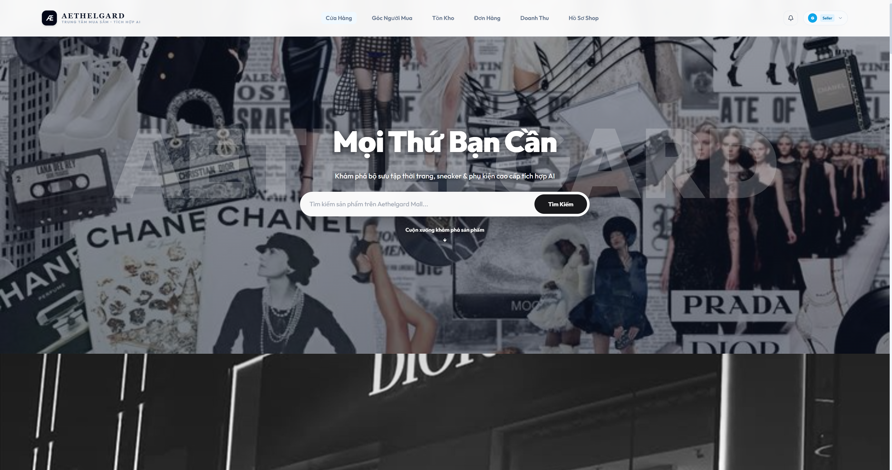
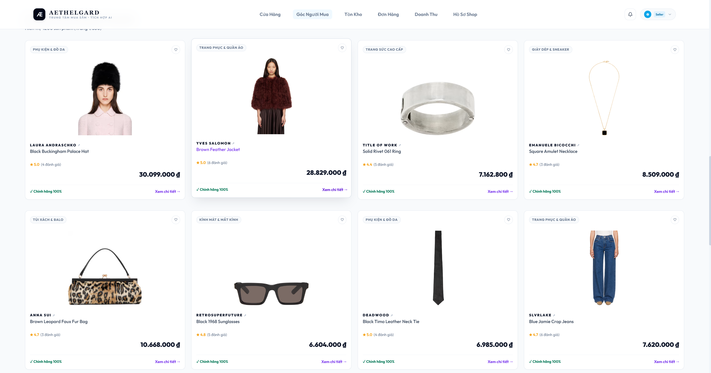
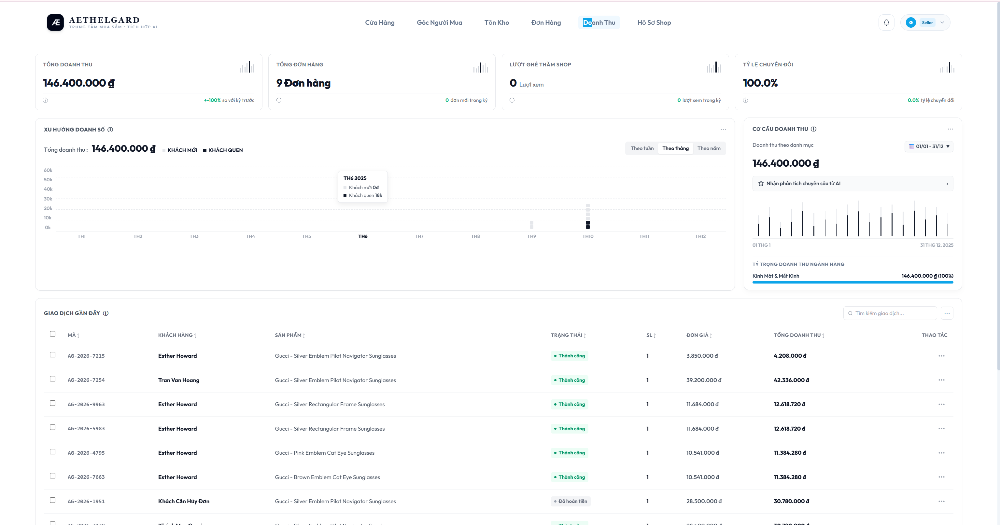
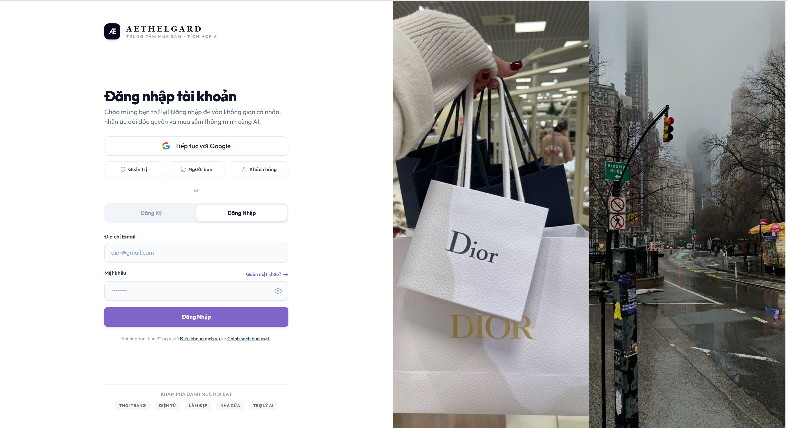

<div align="center">

<h1>Aethelgard Mall</h1>

**Nền tảng Thương mại Điện tử Thời trang Cao cấp**

</div>

---

## Giao diện hệ thống (Screenshots)

### 1. Trang chủ Showroom & Khám phá bộ sưu tập


### 2. Góc Người Mua (Storefront 4,200+ sản phẩm cao cấp)


### 3. Hồ sơ Gian hàng Chính hãng (Flagship Boutique)


### 4. Thống kê Doanh thu & Phân tích AI (Seller Dashboard)


### 5. Đăng nhập / Đăng ký đa vai trò & Google Sign-In


---

## Tính năng nổi bật

- **Xác thực & Phân quyền đa vai trò (`Admin`, `Seller`, `Customer`):**
  - Đăng nhập/Đăng ký bằng Email & Mật khẩu (JWT Bearer Token) hoặc **Google Identity Services (GIS)**.
  - Quên mật khẩu với quy trình xác thực OTP và đánh giá độ mạnh mật khẩu theo thời gian thực.
  - Vue Router navigation guards tự động điều hướng theo vai trò.
- **Trải nghiệm Khách hàng (`/shop`, `/product-detail/:id`, `/shop/wishlist`, `/shop/my-orders`, `/shop/track-order`):**
  - Danh mục 4,200+ sản phẩm thời trang, sneaker, túi xách, kính mát, phụ kiện & trang sức cao cấp.
  - Bộ lọc đa tiêu chí (danh mục, khoảng giá, tìm kiếm, sắp xếp) và phân trang mượt mà.
  - Giỏ hàng, danh sách yêu thích (Wishlist), quy trình thanh toán (COD / VNPay) và theo dõi hành trình vận đơn trực quan.
  - **AI Stylist Panel:** Gợi ý phối đồ thông minh dựa trên ngữ cảnh sản phẩm qua Google Gemini API.
- **Kênh Người bán (`/`, `/inventory`, `/orders`, `/income-statistics`, `/shop-profile`, `/seller/account`):**
  - **Quản lý Tồn kho (`/inventory`):** Theo dõi SKU, định mức tồn an toàn, nhập kho đơn lẻ/hàng loạt, nhật ký biến động kho, xuất CSV và tạo sản phẩm nhanh với **AI Copilot**.
  - **Quản lý Đơn hàng (`/orders`):** Xác nhận, đóng gói (in phiếu đóng gói), giao hàng, hủy đơn có lý do, tra cứu vận đơn qua dual-panel sliding drawer và cập nhật thời gian thực qua **SignalR**.
  - **Thống kê Doanh thu (`/income-statistics`):** KPI Sparkline, biểu đồ Matrix Block & Vertical Needle, phân tích doanh thu chuyên sâu bằng AI và bảng lịch sử giao dịch.
  - **Hồ sơ Shop (`/shop-profile`):** Trình diễn Flagship Editorial Hero, quản lý bộ sưu tập gian hàng và cập nhật thông tin thương hiệu.
- **Quản trị Hệ thống (`/admin`):** Kiểm duyệt Seller, quản lý người dùng, sản phẩm, đối soát thanh toán và cấu hình sàn.

---

## Kiến trúc & Công nghệ

| Thành phần | Công nghệ sử dụng |
| :--- | :--- |
| **Backend** | C# / .NET 10, ASP.NET Core Web API (Clean Architecture: `Ecommerce.API`, `Ecommerce.BLL`, `Ecommerce.DAL`, `Ecommerce.Common`) |
| **Data & Validation** | Entity Framework Core 10, AutoMapper, FluentValidation, Rate Limiting, Global Exception Middleware |
| **Auth & Realtime** | JWT Bearer Authentication, Google Identity Token Validation, SignalR (`NotificationHub`), Swagger / OpenAPI |
| **Frontend** | Vue 3 (`^3.5`), TypeScript (`^5.7`), Vite (`^6.4`), Vue Router 4, Tailwind CSS v3, Lucide Vue Next, Axios, `@microsoft/signalr` |
| **Database** | Microsoft SQL Server (`appsettings.json`) & SQLite cho môi trường dev/test cục bộ (`appsettings.Development.json`) |
| **Testing & DevOps** | xUnit, Moq, `WebApplicationFactory` (5 Unit Tests + 12 Integration Tests), Docker |

---

## Cấu trúc thư mục

```text
├── backend/                               # .NET 10 Web API Solution (Ecommerce.slnx)
│   ├── database/                          # Script SQL Server (schema.sql, seed-data.sql)
│   ├── src/
│   │   ├── Ecommerce.API/                 # Controllers, Middlewares, Hubs, DI & Swagger setup
│   │   ├── Ecommerce.BLL/                 # Business Services, Validators, AutoMapper Profiles
│   │   ├── Ecommerce.DAL/                 # DbContext, Migrations, Repositories, UnitOfWork, Seeder
│   │   └── Ecommerce.Common/              # Entities, DTOs, Enums, Constants, Custom Exceptions
│   ├── tests/
│   │   ├── Ecommerce.Tests.Unit/          # Unit Tests cho Business Logic Layer (5 tests)
│   │   └── Ecommerce.Tests.Integration/   # Integration Tests cho Web API (12 tests)
│   └── Dockerfile
├── frontend/                              # Vue 3 + TypeScript + Vite SPA
│   ├── public/img/                        # Hình ảnh editorial, login slider, sản phẩm fallback
│   └── src/
│       ├── components/                    # Navbar, Footer, NotificationBell, auth/, customer/, seller/, ui/
│       ├── composables/                   # useCatalog, useConfirmDialog
│       ├── lib/                           # constants, customer helpers, password-strength, utils
│       ├── router/                        # Vue Router & Role-based Navigation Guards
│       ├── services/                      # API services (auth, product, order, inventory, ai, admin, signalr...)
│       ├── stores/                        # Reactive state (auth, cart, shopper, toast)
│       ├── styles/                        # Design system stylesheets
│       ├── types/                         # TypeScript domain interfaces
│       └── views/                         # HomeView, ShopView, LoginView, OrdersView, InventoryView, IncomeStatisticsView, ShopProfileView, AdminView...
├── docs/screenshots/                      # Ảnh chụp giao diện thực tế
├── .env.example                           # Mẫu biến môi trường (GEMINI_API_KEY, ports)
├── .gitignore
└── README.md
```

---

## Hướng dẫn cài đặt & chạy dự án

### Yêu cầu môi trường
- [.NET 10 SDK](https://dotnet.microsoft.com/download)
- [Node.js](https://nodejs.org/) (LTS 20+ khuyến nghị) & npm
- SQL Server (nếu chạy chế độ `SqlServer`; môi trường `Development` mặc định dùng SQLite cục bộ)

### 1. Cấu hình biến môi trường
- Ở thư mục gốc: sao chép `.env.example` thành `.env` và điền `GEMINI_API_KEY` (nếu dùng AI Stylist / AI Copilot).
- Ở thư mục `frontend/`: tạo file `.env.local` để bật Google Sign-In:

```env
VITE_API_URL=/api
VITE_GOOGLE_CLIENT_ID=<your_google_client_id>
VITE_APP_ENV=development
```

### 2. Chạy Backend (.NET 10 Web API)

```bash
cd backend
dotnet restore
dotnet run --project src/Ecommerce.API/Ecommerce.API.csproj --launch-profile http
```

- API & Swagger UI (Development): `http://localhost:5000/swagger`
- Để chuyển sang **SQL Server** (`MSSQL$SQLEXPRESS`), cấu hình `"DatabaseProvider": "SqlServer"` cùng `ConnectionStrings` trong `appsettings.Development.json` (hoặc qua `dotnet user-secrets`).

### 3. Chạy Frontend (Vue 3 + Vite)

```bash
cd frontend
npm install
npm run dev
```

- Giao diện Web: `http://localhost:3001` (proxy `/api` và `/hubs` tự động sang `http://localhost:5000`).
- Build production: `npm run build`

---

## Kiểm thử (Testing)

Chạy toàn bộ Unit Tests và Integration Tests của Backend:

```bash
cd backend
dotnet test Ecommerce.slnx
```

Kết quả mong đợi: **17/17 tests passed** (`5` Unit Tests + `12` Integration Tests).
